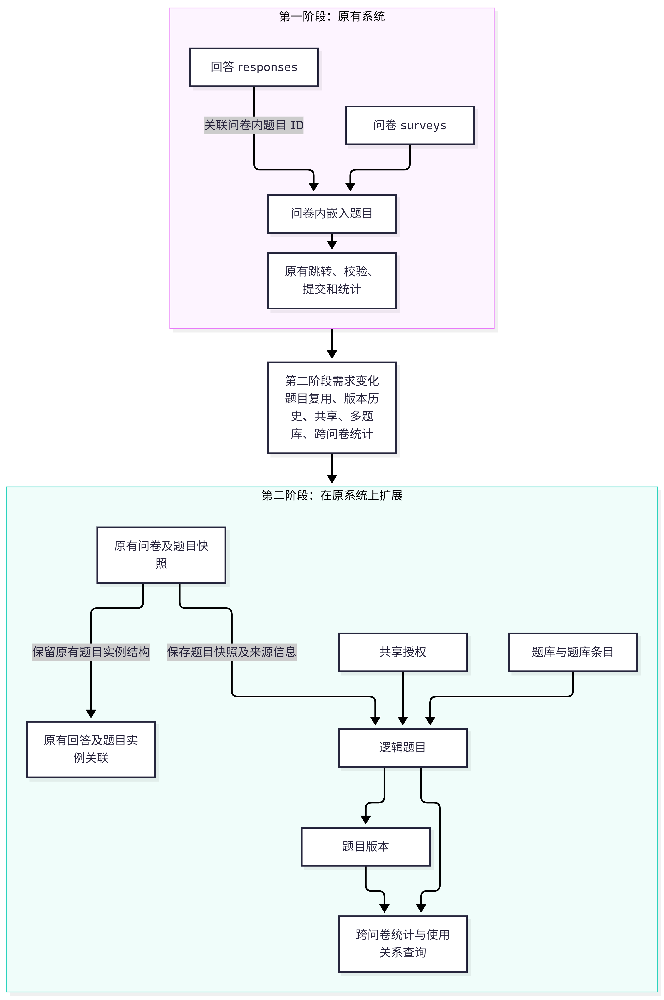
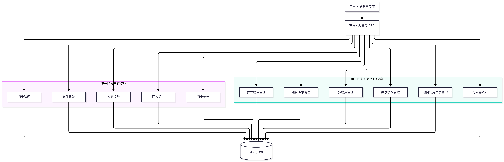
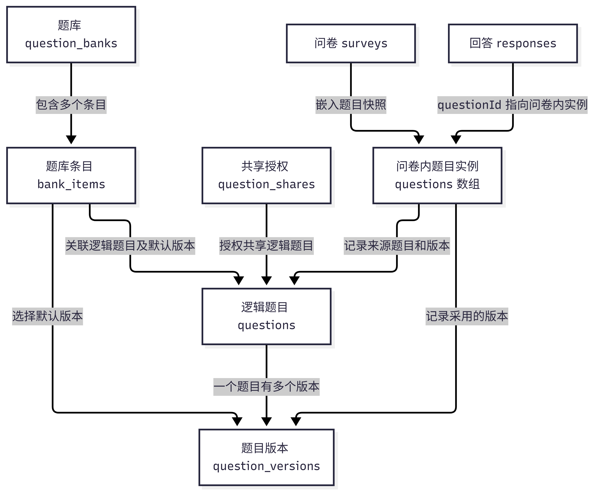

# 基于 MongoDB 的问卷系统第二阶段项目完成报告

## 一、项目背景与需求变化

### 1.1 项目目标

本项目第一阶段实现了基于 MongoDB 的问卷系统，主要功能包括用户注册与登录、问卷创建、题目管理、条件跳转、答案校验、问卷提交和结果统计。原有系统将题目嵌入问卷文档中，能够较为直接地完成问卷的创建、填写和统计。
第二阶段在第一阶段成果的基础上进行扩展，新增独立题目管理、题目版本管理、指定用户共享、多题库管理、题目使用关系查询和跨问卷统计等功能。与第一阶段相比，系统不仅需要管理问卷，还需要支持题目的长期保存、复用、修改历史追踪和跨用户使用。

这些需求带来了新的数据库设计问题：如何区分题目本身与题目的某个版本，如何避免修改共享题目时影响已有问卷，如何管理共享权限，以及如何判断不同问卷中的答案是否适合合并统计。因此，第二阶段要在保留第一阶段核心业务流程的基础上，增加独立的题目管理机制，并协调新旧数据结构之间的关系。

### 1.2 需求变化与设计思路

第一阶段以问卷为中心，题目主要属于具体问卷；第二阶段则需要将题目作为独立对象进行管理。为此，系统在原有问卷、回答和参与记录等数据结构之外，增加了逻辑题目、题目版本、题库、题库条目和共享授权等数据结构。

*图1 第一阶段与第二阶段数据库设计演进图*

如图1所示，第二阶段保留了原有问卷内题目实例及其回答关联，同时增加独立题目和版本管理机制。原有问卷继续保存题目快照，新增的逻辑题目和版本信息则用于支持题目复用、历史追踪、共享与跨问卷统计。

这一设计使新增功能能够与原有系统协同工作，减少对原有填写、跳转和答案校验流程的整体改造。

## 二、系统整体架构与模块划分

### 2.1 系统架构

本系统采用 Python、Flask 和 MongoDB 实现。浏览器通过页面访问系统，Flask 负责处理页面请求与 JSON API 请求，后端业务模块完成数据操作、权限检查、答案校验和条件跳转计算，MongoDB 负责保存业务数据。

*图2 系统整体架构与模块划分图*

图中将系统划分为第一阶段已有模块和第二阶段新增或扩展模块。原有模块继续负责问卷管理、条件跳转、答案校验、回答提交和问卷统计；新增模块负责独立题目、题目版本、多题库、共享授权、题目使用关系查询和跨问卷统计。

这样的模块划分主要考虑两个方面。一方面，原有功能已经具有相对明确的职责，没有必要为了新增题目复用功能而全部重写；另一方面，题目版本、共享关系和题库具有独立的业务规则，将它们单独组织有利于控制权限、处理版本变化和开展针对性测试。

各模块通过 Flask 路由与 API 接收请求，再调用对应的数据模型和业务逻辑完成处理。数据库操作集中在相应的数据访问模块中，有利于避免在页面处理代码中直接混杂大量数据库操作。

### 2.2 前后端与数据库的协作

前端页面负责展示数据和提供操作入口，后端负责检查请求是否合法、当前用户是否具有相应权限，以及数据修改是否满足业务规则。MongoDB 则保存经过业务处理的数据。

例如，前端可以提供创建新版本的按钮，但是否允许创建新版本、当前版本是否发生冲突，仍由后端检查。类似地，前端可以展示共享题目，但接收者能否继续使用该题目，需要根据数据库中的授权状态和题目状态进行判断。
这种分工可以减少对前端限制的依赖，使关键业务约束集中在服务端处理。

## 三、MongoDB 数据库设计与方案取舍

### 3.1 原有数据结构及其合理性

第一阶段主要使用 users、surveys、responses 和 participations四个集合。

| 集合 | 保存内容 | 设计理由 |
|---|---|---|
| users | 用户账号、密码哈希和注册时间 | 用户具有独立的生命周期，需要独立管理 |
| surveys | 问卷基本信息、设置、题目和跳转规则 | 问卷配置通常整体读取，嵌入题目便于获取完整问卷 |
| responses | 用户提交的回答和相关记录 | 回答会持续增长，独立保存便于按问卷查询和统计 |
| participations | 用户参与资格及相关提交状态 | 将参与控制与回答内容分开，支持重复填写限制 |

第一阶段采用嵌入与引用相结合的方式，而不是将所有数据全部嵌入问卷或全部拆分为独立集合。问卷中的题目通常需要与问卷设置、题序和跳转规则一起读取，因此嵌入式结构比较合适；回答数量则会随着用户提交持续增长，独立保存更便于管理和统计。

这种设计适合第一阶段的业务范围，但当题目需要跨问卷复用、共享和版本管理时，仅依靠问卷内部的题目数组就难以满足新的需求。

### 3.2 逻辑题目与题目版本分离

第二阶段的设计调整，是将逻辑题目与题目版本分开管理。
逻辑题目表示一个可以长期保存和复用的题目身份，题目版本则表示该逻辑题目在某一时刻的一份确定内容。题目修改后创建新版本，而不是直接覆盖原有版本。
| 标识 | 含义 | 主要用途 |
|---|---|---|
| 问卷内题目实例 ID | 某道题在一份具体问卷中的实例 | 题目排序、跳转和回答关联 |
| 逻辑题目 ID | 可以长期管理和复用的题目身份 | 题目所有权、来源追踪和跨问卷查询 |
| 题目版本 ID | 逻辑题目的某一份确定内容 | 历史查看、版本切换、恢复和统计分组 |

将这三类标识分开，是因为它们承担的职责不同。即使两份问卷使用同一个逻辑题目和同一个版本，也需要拥有各自的问卷题目实例，以便独立配置题序、必答要求和条件跳转。
如果将这些标识混为一体，就容易出现版本修改影响历史问卷、回答关联错误或跨问卷统计无法准确识别来源等问题。

### 3.3 保留问卷快照的原因

在题目复用方案上，本项目选择的方案是将选定版本的题目内容复制到问卷中，同时保存逻辑题目 ID 和版本 ID 等来源信息。

这一选择主要考虑了与第一阶段代码的兼容性。原有问卷填写、条件跳转、答案校验和回答提交均围绕问卷内的题目实例运行。如果改为问卷仅保存版本引用，就需要进一步调整题目读取、历史问卷处理和回答关联等逻辑。

保留题目快照后，问卷可以直接使用自身保存的题目内容。题库中的题目即使创建了新版本，也不会自动改变已经保存的问卷。来源信息则为后续的版本追踪和跨问卷统计提供依据。

这种设计也会产生一定的数据冗余，但本项目更重视已有问卷内容的稳定性和原有业务逻辑的兼容性。因此，数据冗余是经过权衡后接受的代价，而不是单纯的设计缺陷。

### 3.4 新增集合及其关系

第二阶段新增了独立题目管理相关的数据结构。逻辑题目集合用于保存题目身份、所有权和当前版本等信息；题目版本集合保存不同版本的内容；题库及题库条目用于组织用户自己的常用题目；共享授权集合用于记录题目所有者向其他用户授予的使用权限。

*图3 核心集合与题目复用关系图*

图 3 展示了第二阶段的核心数据关系。其中，`question_banks` 保存题库，`bank_items` 保存题库中的条目，`question_shares` 保存共享授权，`questions` 保存逻辑题目，`question_versions` 保存题目版本。`surveys` 仍然保存问卷及其嵌入式题目实例，`responses` 通过问卷内题目实例 ID 关联回答。

这些数据结构分别管理不同的业务对象，避免将题库、共享授权和版本历史全部塞进问卷文档中。这样既保留了原有问卷的读取方式，也能够独立管理题目版本、题库条目和授权关系。

### 3.5 Schema 校验与索引设计

MongoDB 的 Schema 校验用于约束文档的基本结构和字段类型，而后端业务逻辑负责检查更具体的规则。例如，题目版本是否属于指定逻辑题目、共享授权是否有效、目标版本是否可以使用，以及答案是否符合题型要求，都不能只依赖字段类型校验。

第一阶段已经使用索引支持常用查询和关键约束，包括用户名唯一索引、问卷所有者索引、回答的问卷索引，以及参与记录的复合唯一索引。
| 集合 | 索引 | 设计目的 |
|---|---|---|
| users | username 唯一索引 | 防止用户名重复 |
| surveys | ownerId 普通索引 | 支持按创建者查询问卷 |
| responses | surveyId 普通索引 | 支持按问卷查询回答和统计 |
| participations | (surveyId, userId) 复合唯一索引 | 防止同一账号重复取得同一问卷的参与资格 |

这些索引体现了两种不同用途：普通索引主要改善查询效率，唯一索引则同时承担数据完整性约束。尤其是参与记录的复合唯一索引，可以在并发请求同时到达时阻止重复参与记录，避免仅依赖应用层先查询再插入所产生的竞争问题。

## 四、关键业务逻辑与设计依据

### 4.1 题目版本管理

题目版本管理的核心原则是保留历史内容。创建新版本时，系统保存新内容及其变更依据；查看历史版本时，可以查询之前的内容；恢复历史版本时，则通过创建新版本保留恢复操作的历史，而不是直接删除中间版本。

考虑到多个请求可能同时修改同一题目，系统还引入了依据版本、预期修订号和操作标识等机制。它们用于判断请求是否基于当前有效状态，减少并发修改造成的静默覆盖。

当一个修改不能直接成为当前版本时，系统可以保留该版本作为分支。这样做并不意味着系统能够自动合并所有修改，而是为冲突保留明确记录，便于后续选择。

### 4.2 题目共享与多题库

本项目采用指定用户共享，而不是让所有用户默认访问全部题目。题目所有者可以向指定用户授予权限，接收者则在授权有效、题目可用的条件下使用共享题目。

共享权限与所有权需要明确区分。接收者获得的是规定范围内的题目使用权限，并不因此获得原题的完整版本管理权限，也不能查询其他用户问卷的回答。

撤销共享后，原授权不再允许接收者通过该关系继续选题，但已有合法问卷快照和独立副本应继续保留。这是因为授权控制的是后续使用，而不是已经建立的数据是否存在。

多题库设计则用于让每个用户根据自己的需要组织题目。题库条目与逻辑题目分开保存，可以避免删除题库时误删原题或其他问卷中的快照。

### 4.3 跨问卷统计与兼容性管理

跨问卷统计需要识别逻辑题目、版本来源以及相应回答，不能仅根据题目标题相同就认为它们属于同一道题。

例如，同一逻辑题目的两个版本可能具有不同的选项含义、题型或数字单位。如果直接合并所有答案，统计结果就可能失去可比性。

因此，本项目提供整体汇总和版本明细，并采用由题目所有者确认统计兼容性的设计。系统需要结合题目来源、版本关系和答案有效性进行判断，而不是无条件合并全部历史数据。

同时，提交数、有效答案数和独立用户数具有不同含义。统计时需要根据实际字段定义选择正确的计数口径，避免把不同指标混为一谈。

### 4.4 原有跳转、校验与提交流程的兼容

第二阶段仍然使用问卷内题目实例 ID 关联回答，条件跳转也继续围绕具体问卷中的题目实例执行。逻辑题目 ID 和版本 ID 主要用于题目管理、来源追踪和跨问卷统计，不直接替代原有题目实例标识。

当题目被引入问卷或切换到其他版本时，系统需要检查题目来源、版本归属以及现有跳转规则是否仍然有效。答案校验继续由服务端执行，保证必答要求、选项合法性和数值限制等规则不会仅依赖前端输入限制。

这种设计让第二阶段的新功能能够与原有业务协同，而不是因为增加题目复用功能就破坏第一阶段的填写和提交流程。

## 五、测试与实施结果

### 5.1 分批实施与测试

第二阶段采用分批实施方式，每一批聚焦一组相对独立的功能，并在继续扩展前检查测试结果。

| 阶段 | 主要实施内容 | 历史测试结果 |
|---|---|---|
| 第一批 | 确认设计基线、测试环境和原有功能状态 | 39 次执行，其中 24 次通过、15 次跳过 |
| 第二批 | 独立题目、初始版本、问卷快照和副本 | 累计 72 次通过 |
| 第三批 | 版本历史、恢复、分支和并发控制 | 累计 94 次通过 |
| 第四批 | 指定用户共享、授权撤销与多题库 | 累计 116 次通过 |
| 第五批 | 使用关系、跨问卷统计和兼容性管理 | 首轮 141 次中 138 次通过；修正后累计 145 次通过 |
| 第六批 | 前端页面整合与新旧功能联调 | 累计 146 次通过 |

第一批的 15 次跳过主要是当时未启用真实数据库测试条件，并不表示对应功能测试失败。第五批首轮出现 3 次失败。根据历史实施记录，检查后发现问题与测试中的故障模拟对象和实际调用对象不一致有关。调整测试方式并补充场景后，最终记录为 145 次通过；第六批完成后，累计记录为 146 次通过。

第六批测试记录包括 41 次非数据库测试执行和 105 次真实 MongoDB 测试执行。此外，还保存了 23 组浏览器自动化流程通过的记录。浏览器流程与自动化测试执行采用不同统计口径，不应直接相加后当作独立测试用例总数。

### 5.2 测试覆盖范围

本项目的测试覆盖原有问卷业务及第二阶段新增功能，主要通过自动化测试和浏览器流程测试，检查各模块的业务逻辑、数据关系、权限约束与页面交互。

| 测试模块 | 主要验证内容 | 验证方式 |
|---|---|---|
| 原有业务回归 | 问卷管理、题目配置、条件跳转、答案校验、提交和统计 | 自动化回归测试 |
| 题目版本管理 | 版本创建、历史查询、恢复、并发冲突处理 | 自动化测试 |
| 共享与多题库 | 用户授权、撤销与重授权、题库隔离和条目管理 | 自动化测试与业务流程检查 |
| 跨问卷统计 | 题目来源关系、整体汇总、版本明细和统计兼容性 | 自动化测试 |
| 浏览器交互 | 页面操作、题目复用及各功能之间的联动 | 浏览器自动化测试 |

### 5.3 当前限制

本项目目前仍存在一些需要进一步完善的方面。旧问卷的历史回答不会在题目另存为独立逻辑题目时自动映射为新题目的历史回答；不同版本的答案也不会自动无条件合并。列表和统计尚未针对大规模数据进行充分的性能优化与压力测试。

此外，虽然系统通过版本修订、操作标识和权限检查处理了多种冲突场景，但跨集合写入并不等于统一的数据库事务，仍需要关注操作中断和并发状态变化等情况。因此，当前成果主要体现为课程项目范围内的功能扩展与已有测试场景验证，不能将其直接等同于经过全面生产环境验证的系统。

## 六、AI 辅助开发与个人参与

本项目开发过程中使用 ChatGPT 讨论需求、数据库结构和方案取舍，并使用 Codex 结合本地项目文件分批实施代码修改、编写测试和整合前端页面。

在方案讨论阶段，我重点关注新需求与第一阶段已有代码之间的关系。例如，题目复用可以采用只保存版本引用的方式，也可以采用复制版本内容并保留来源信息的方式。经过讨论，我最终选择后者以减少对原有问卷填写、跳转、校验和提交流程的改造。

在实施阶段，按照功能范围分批推进，并根据测试输出检查问题。第五批首轮测试出现失败后，结合实际执行方式检查故障模拟逻辑，再进行修正和补充测试。

AI 提高了代码实现和测试整理的效率，但生成的代码仍然需要结合现有项目结构和实际运行结果进行核对。本人主要参与需求确认、方案选择、实施范围控制、运行结果反馈和复测；具体工具、提示词、代码修改及验证情况见项目的 AI 使用日志。

| 阶段 | AI 的主要作用 | 本人的参与 |
|---|---|---|
| 需求分析 | 协助梳理新需求与原有结构的关系 | 确认功能范围和设计目标 |
| 数据库设计 | 提供数据模型与方案比较建议 | 选择题目快照与来源追踪方案 |
| 分批实施 | 协助修改代码、编写测试和整合页面 | 检查实施范围与运行结果 |
| 问题排查 | 根据测试输出分析问题并提出修正方式 | 反馈实际现象、核对修正结果 |

## 七、开发过程中遇到的问题及解决方法

### 7.1 真实数据库测试的执行条件问题

第二阶段初期运行测试时，部分真实 MongoDB 测试被跳过。根据当时的测试输出，第一批共执行 39 次测试，其中 24 次通过、15 次跳过，没有出现失败。检查后发现，真实数据库测试需要设置 `RUN_MONGO_TESTS=1` 才会启用。

针对这一情况，后续将普通单元测试与真实数据库集成测试区分开，并使用隔离的测试数据库运行数据库相关测试。这样可以检查实际数据库操作，同时避免测试数据直接影响正式业务数据。

通过这次检查，我认识到测试整体显示通过并不意味着所有功能都已经得到验证。还需要查看测试是否被跳过、是否满足执行条件，以及真实数据库相关操作是否确实运行。

### 7.2 第五批测试失败及修正

第五批首轮测试中，141 次测试执行有 138 次通过、3 次失败。根据当时的实施记录，失败原因与故障注入测试的模拟对象不一致有关：测试设置故障的集合对象与实际业务代码调用的对象不一致，导致预期的故障没有按测试设计发生，进而触发断言失败。

随后调整了故障注入对象，并补充了相关测试。修正后，第五批累计 145 次测试全部通过，第六批累计 146 次测试全部通过。

这次问题使我认识到，测试失败需要结合业务代码、测试模拟方式和断言条件进行分析，不能直接把所有失败都判断为业务功能缺陷。修改后还需要重新运行测试，确认结果符合预期。

## 八、总结与个人思考

通过第二阶段的开发，我认识到，系统增加新功能时，不能只考虑功能本身，还需要考虑它与原有数据结构和业务流程的关系。例如，本项目通过区分逻辑题目、题目版本和问卷内题目实例，在支持题目复用的同时，尽量保持原有问卷内容和填写流程稳定。

这次实践也让我体会到，数据库设计需要根据实际需求权衡，而不是一味追求结构简单或功能全面。AI 辅助开发提高了实现效率，但方案选择、运行结果检查和问题判断仍然需要自己参与。通过两个阶段的项目完善，我理解了系统如何在保留原有成果的基础上逐步适应新的需求，以及在实际开发过程中软件系统不是一次设计完成的，而是在不断变化的需求中逐步演化的。